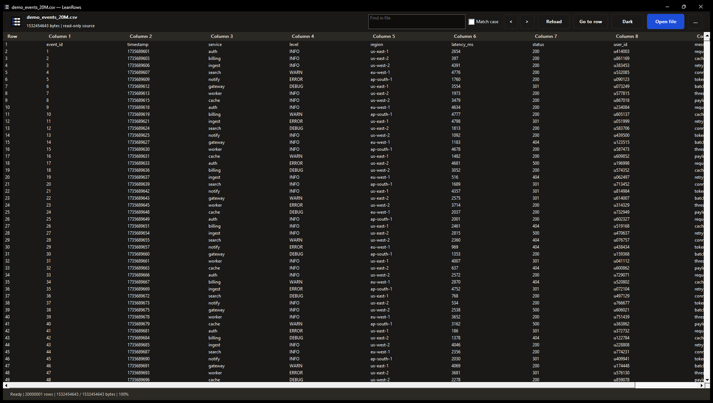

# LeanRows: a free large CSV viewer for Windows

**Open CSV files too big for Excel, without loading them into memory.**

[Website](https://abooodbah.github.io/leanrows/) · [Microsoft Store](https://apps.microsoft.com/detail/9NMV8GKJXSN0) · [Releases](https://github.com/abooodbah/leanrows/releases) ([feed](https://github.com/abooodbah/leanrows/releases.atom)) · [All Lean apps](https://abooodbah.github.io/)

[](https://github.com/microsoft/winget-pkgs/tree/master/manifests/a/abooodbah/LeanRows) [](https://github.com/abooodbah/leanrows/releases/latest) [](LICENSE) [](https://github.com/abooodbah/leanrows/releases)



**Excel stops at 1,048,576 rows. LeanRows fully indexed a 20,000,001-row, 1.5 GB
CSV (1,532,454,643 bytes) at a peak working set of 18.4 MB.**

```powershell
winget install abooodbah.LeanRows
```

It also opens TSV, JSONL, logs and Excel `.xlsx` workbooks (read-only, one sheet
at a time). The portable ZIP needs no installer, runtime, or admin rights. Most
tools that go past Excel's limit are paid, need an installer, or live in a
terminal. LeanRows is a single executable (1,062,400 bytes in v0.6.0) you can
copy onto a locked-down work machine and run. For the other options, see
[how to open a CSV file that is too large for Excel](https://abooodbah.github.io/leanrows/open-csv-too-large-for-excel/).

It is strictly read-only, so it cannot alter the file it is inspecting. There is
no telemetry and no network access of any kind.

## Install

Download the portable ZIP from the
[latest release](https://github.com/abooodbah/leanrows/releases/latest), extract
it, and run `leanrows.exe`. Outside that folder, LeanRows writes only its
theme and zoom settings, under `HKCU\Software\LeanRows`, and a scratch folder for
search results, under `%LOCALAPPDATA%\LeanRows`. Column sorting also keeps
temporary sort data there.

### winget

LeanRows is in the winget community repository. winget installs the portable
ZIP from the GitHub Release after checking its SHA-256 and adds a `leanrows`
command:

```powershell
winget install abooodbah.LeanRows
```

### Microsoft Store

<a href="https://apps.microsoft.com/detail/9NMV8GKJXSN0"></a>

LeanRows is also in the [Microsoft Store](https://apps.microsoft.com/detail/9NMV8GKJXSN0). The Store build is
signed by Microsoft, so Windows installs it without the SmartScreen warning
that the unsigned GitHub ZIP can show. It can also be installed from the Store
with winget:

```powershell
winget install --id 9NMV8GKJXSN0 --source msstore
```

### Scoop

```powershell
scoop bucket add lean https://github.com/abooodbah/scoop-bucket
scoop install lean/leanrows
```

### Chocolatey

From an administrator PowerShell:

```powershell
choco install leanrows -y
```

The [LeanRows package](https://community.chocolatey.org/packages/leanrows) installs
the portable Windows ZIP from the GitHub release, checks its SHA-256, and adds a
Start menu shortcut and a command-line shim. To move an existing Chocolatey
installation to the newest release:

```powershell
choco upgrade leanrows -y
```

A new version reaches Chocolatey once its moderators have approved the package,
which can take a few days after the GitHub release.

### Android (closed test)

LeanRows for Android is in a closed test on Google Play before its public release.
To try it:

1. Join the [Lean Apps testers group](https://groups.google.com/g/lean-apps-testers) with the Google account you use
   on your phone.
2. On your phone, open the [LeanRows tester page](https://play.google.com/apps/testing/io.github.abooodbah.leanrows), tap
   **Become a tester**, then install LeanRows from Google Play.

If the tester page says the app is not available yet, Google is still reviewing
the test; try again a day later. Google asks testers to keep the app installed
for 14 days. The APK is also attached to each
[Android release](https://github.com/abooodbah/leanrows-android/releases).

## Supported formats

CSV, TSV, JSONL, NDJSON, log, plain text, and `.xlsx` workbooks (stored cell
values, read-only), on Windows x64. CSV and TSV record
boundaries are quote-aware across read blocks, including quoted fields containing
newlines. JSONL, NDJSON, log, and text files are treated as line-oriented records.

## How it stays small

The file is indexed progressively as you move through it, and only the rows
currently in the viewport are materialized. Peak memory is governed by window
size rather than file size, which is why the figure above stays flat whether the
source is 15 MB or 1.5 GB.

LeanRows is for viewing large row-based data files without loading everything
into memory. [LeanMark](https://github.com/abooodbah/leanmark), a Markdown
viewer, is for reading Markdown documents and Mermaid diagrams in a clean,
focused interface, and [LeanDoc](https://github.com/abooodbah/leandoc), a Word
document viewer, is for reading `.docx` files without opening an office suite. All three are read-only tools designed to make
local files easier to inspect without changing them.

## Why LeanRows

- **Progressive viewing:** the first bounded viewport is prepared before the
  background index reaches the end of a large file.
- **Bounded data structures:** fixed-capacity checkpoints, viewport caches,
  previews, and coalescing worker queues prevent memory use from scaling with
  the source file by design.
- **Read-only snapshots:** LeanRows never edits, imports, or rewrites the source.
- **Focused inspection tools:** inline literal search, absolute-row navigation,
  and bounded clipboard copy operate without constructing a whole-file model.
- **Native Windows interface:** a responsive command bar and virtual owner-data
  grid use Win32 controls rather than a browser engine or bundled web runtime.
- **Local operation:** the application contains no telemetry, update checker,
  account system, or network retrieval path.
- **Visible malformed data:** invalid bytes are escaped and oversized values are
  marked as truncated instead of being silently normalized.

## Download

The official package is attached to the
[GitHub release](https://github.com/abooodbah/leanrows/releases/latest) as:

```text
LeanRows-v0.6.0-windows-x64-unsigned.zip
LeanRows-v0.6.0-windows-x64-unsigned.sha256
```

LeanRows 0.6 is not Authenticode-signed. Windows may therefore show a security
warning. Verify the downloaded ZIP before running it:

```powershell
Get-FileHash .\LeanRows-v0.6.0-windows-x64-unsigned.zip -Algorithm SHA256
```

The result must match the value in the accompanying `.sha256` file from the
same release.

## Run or install

The extracted ZIP is portable. Launch `leanrows.exe` directly, pass one or more
supported file paths on the command line, use **Open file** or `Ctrl+O`, or drop
supported files onto the window. Each file opens in its own tab.

While LeanRows is running, a file opened from Explorer or the command line joins
the running window as a new tab, so every open file shares one process. A copy
started from a different folder, such as a portable copy next to an installed
one, keeps its own window.

An optional per-user installation is also included:

```powershell
.\install.ps1 -ValidateOnly
.\install.ps1
```

`-ValidateOnly` checks the package manifest and file hashes without changing
files or the registry. Installation places LeanRows under
`%LOCALAPPDATA%\Programs\LeanRows` and registers it as an available handler for
`.csv`, `.tsv`, `.jsonl`, `.ndjson`, and `.log`. Where an extension has no
protected Explorer `UserChoice`, the installer records its prior direct
per-user default and makes LeanRows the direct per-user default. Protected
choices and `.txt` remain untouched. The installer also adds LeanRows to the
current user's Start menu and Installed Apps list.

Run the installed uninstaller with:

```powershell
& "$env:LOCALAPPDATA\Programs\LeanRows\uninstall.ps1"
```

See the [installer contract](installer/README.md) for the exact package and
registry behavior.

## Supported input

| Format | Extensions | v0.6 behavior |
| --- | --- | --- |
| Comma-separated data | `.csv` | Quote-aware logical records in independently bounded native columns |
| Tab-separated data | `.tsv` | Quote-aware logical records in independently bounded native columns |
| JSON Lines | `.jsonl`, `.ndjson` | One physical line per displayed record; no schema or JSON-tree view |
| Logs and text | `.log`, `.txt` | One physical line per displayed record |
| Excel workbooks | `.xlsx` | One worksheet at a time, stored values as text; see [XLSX cell text](docs/XLSX.md). Opened from LeanRows or the command line; the installer does not register `.xlsx`. |

Format selection is extension-based in 0.6. Input is treated as bytes and
decoded for display as UTF-8; invalid bytes are shown as `\xNN`. Long records,
fields, and display strings use bounded previews and are marked when truncated.

LeanRows 0.6 deliberately excludes editing, saving, export, filtering,
regular expressions, SQL, charts, archives, remote or UNC paths, reparse points,
tail/follow mode, plug-ins, scripts, and arbitrary JSON documents remain excluded.

## Column sorting

Click a data-column header to sort the entire document ascending; click it again
to reverse direction. Right-click the header for text or numeric ordering.
The More menu exposes the same commands for the last selected sort column
(initially the first column). Click Row or choose Restore source order to reset.
More > Cancel sort stops pending work while keeping the last completed view.

Sorting runs in the document worker, with a process-wide 16 MiB managed-memory
limit and 8 GiB temporary-disk quota. Only one sort runs at a time; a sort in
another tab waits for it rather than cancelling it. A sort needs about 256 bytes
of temporary disk space per row at its peak (about 2.4 GB for 10 million rows),
so files above roughly 33 million rows cannot be sorted. LeanRows checks the
free space before it starts and says so if the drive is too full. No database is
created and the source is never rewritten. Closing/reloading releases the sort
data.

Text order compares complete decoded bytes, case sensitively and without locale
collation; displayed truncation does not truncate the sort key. Numeric mode
compares decimal integers, fractions and scientific notation exactly, without
floating-point rounding. Numbers precede text and empty/missing values in both
directions. Equal keys retain original row order. CSV/TSV's first record remains
data. Row numbers, Find results and Go to row identify the original source rows.
Sorting is not available for `.xlsx` workbooks yet; it reports that instead.

## Hiding columns

Right-click a column header and choose Hide column to take that column out of
the view. Show all columns, on the same menu, brings every hidden column back.
The More menu has both commands, with a Hide column submenu that lists the
shown columns, so they also work from the keyboard. The last shown column
cannot be hidden, so a text, log or JSONL file, which shows one Preview column,
has nothing to hide.

Hiding a column changes the view only. The file is not changed and nothing is
saved: each tab keeps its own hidden columns until the file is reloaded or
another file or sheet is shown in it. Hidden columns are left out of `Ctrl+C`
copies and of horizontal scrolling.

LeanRows never loads whole columns into memory, so hiding one saves screen
space rather than memory. For the rows on screen, LeanRows skips decoding the
hidden fields. Sorting by a column and then hiding it keeps the order, and the
status bar marks the sorted column as hidden. Find still searches whole rows,
hidden columns included, and the status bar says so while a search result is
shown.

## Snapshot behavior

An open document is a read-only snapshot. On Windows, the retained file handle
allows reads and atomic replacement but does not share in-place writes. An
editor that appends to, truncates, or rewrites the same file may receive a
sharing violation while it remains open in LeanRows. Editors that save by
atomic replacement can proceed; LeanRows detects the changed path identity and
requires a reload before continuing.

This behavior prevents indexed offsets from being combined with different file
bytes. Closing the document releases the retained handle.

## Memory model

LeanRows does not load the complete document, store an offset for every row, or
create a full in-memory object model. It reads positioned blocks, maintains a
fixed-capacity adaptive index, and decodes only bounded record previews for the
active viewport. A single large record is scanned incrementally rather than
allocated as one buffer.

Literal Find uses fixed read and result-page buffers. Its result positions are
stored in an application-owned scratch file capped at 64 MiB under
`%LOCALAPPDATA%\LeanRows\query-cache`, never beside the source. Find is
demand-driven: it advances only far enough to answer the current next or
previous request. Owned scratch files are removed after use, and stale-file
recovery is coordinated across concurrent LeanRows processes.

Every open file shares one process. Each tab has its own background worker,
file handle, index, and cached row window; a tab that is not showing keeps its
rows in the same allocation its worker already holds, so switching tabs copies
nothing. At most 32 files can be open at once. A window with no open file runs
no worker thread, and minimizing the window asks Windows to page out the
process until it is used again.

These bounds apply to data-dependent application structures, not to a fixed
whole-process RAM guarantee. Executable pages, Windows controls, thread stacks,
allocator overhead, and the operating-system file cache are separate. Release
qualification records full process-tree memory independently; see
[Acceptance and assurance](docs/ACCEPTANCE.md).

## Keyboard and accessibility

- `Ctrl+O` opens the native file picker.
- `Ctrl+F` focuses the inline literal-search field. `Enter` or `F3` moves to the
  next match; `Shift+Enter` or `Shift+F3` moves to the previous stored match.
- `Ctrl+G` jumps to a checked, one-based absolute row number.
- `Ctrl+C` copies selected cached rows as tab-delimited Unicode text. One
  operation is limited to 4,096 rows and 1 MiB, including the terminator.
  Hidden columns are not copied.
- More > Hide column hides a column from the view, and More > Show all columns
  shows them again, the same commands as a right-click on a column header.
- `F5` reloads the active path as a new snapshot.
- `Ctrl+Plus`, `Ctrl+Minus` and `Ctrl+0` zoom the rows in, out and back to
  actual size, as does `Ctrl` with the mouse wheel over the rows. The steps
  are LeanMark's, from 50% to 300%. Only the rows and their column titles
  zoom; the toolbar and tabs keep their size. The zoom is remembered.
- `Ctrl+/` or `F1` opens the settings panel, and `Escape` closes it. The
  panel, as in LeanMark, has the theme, the zoom, and the list of every
  keyboard shortcut and mouse action, sorting included. The settings button
  next to Open does the same.
- `Ctrl+Shift+T` changes the theme, as the theme button does. The button shows
  a coloured dot for the current theme, and its tooltip names the theme.
- `Ctrl+Tab` and `Ctrl+Shift+Tab` (or `Ctrl+PgDn` and `Ctrl+PgUp`) move between
  tabs. `Ctrl+1` to `Ctrl+8` pick a tab by position and `Ctrl+9` picks the last
  one. `Ctrl+W` or `Ctrl+F4` closes the current tab; a middle click closes any
  tab.
- Standard list navigation keys move through the virtual row control.

Find compares raw UTF-8 bytes. Its optional case-insensitive mode folds ASCII
letters only; non-ASCII bytes remain exact. Regular expressions are not
supported in 0.6.

The interface provides five themes, the same as LeanMark: System, Light, Dark,
Dim, and Dusk. Dim and Dusk are softer dark themes. System follows the active
Windows app theme. The application also provides per-monitor DPI
handling, visible keyboard focus, and Microsoft Active Accessibility names for
the window, grid, and row items. When Windows high contrast is active,
application colors yield to the corresponding system colors.

## Build from source

The workspace pins Rust 1.97.1:

```powershell
rustup toolchain install 1.97.1 --profile minimal --component rustfmt,clippy
cargo +1.97.1 build --release --locked -p leanrows-app
```

The release executable is written to `target/release/leanrows.exe`. Building
the Windows application requires the Windows SDK resource compiler (`rc.exe`)
because the manifest and application icon are embedded at build time.

Run the repository checks with:

```powershell
cargo +1.97.1 fmt --all -- --check
cargo +1.97.1 test --workspace --all-targets --locked
cargo +1.97.1 clippy --workspace --all-targets --locked -- -D warnings
.\scripts\Test-ReleaseEngineering.ps1
```

## Project documentation

- [Architecture](docs/ARCHITECTURE.md)
- [Acceptance and assurance](docs/ACCEPTANCE.md)
- [Validation status](docs/VALIDATION_STATUS.md)
- [LeanRows 0.6.0 release notes](docs/releases/v0.6.0.md)
- [LeanRows 0.5.1 release notes](docs/releases/v0.5.1.md)
- [LeanRows 0.5.0 release notes](docs/releases/v0.5.0.md)
- [LeanRows 0.4.0 release notes](docs/releases/v0.4.0.md)
- [LeanRows 0.3.0 release notes](docs/releases/v0.3.0.md)
- [LeanRows 0.2.0 release notes](docs/releases/v0.2.0.md)
- [LeanRows 0.1.3 release notes](docs/releases/v0.1.3.md)
- [LeanRows 0.1.2 release notes](docs/releases/v0.1.2.md)
- [LeanRows 0.1.1 release notes](docs/releases/v0.1.1.md)
- [Security policy](SECURITY.md)
- [Roadmap](ROADMAP.md)
- [Contributing](CONTRIBUTING.md)
- [Changelog](CHANGELOG.md)
- [Citation metadata](CITATION.cff)

## License

LeanRows is available under the [MIT License](LICENSE).

## Privacy policy

This program will not transfer any information to other networked systems
unless specifically requested by the user or the person installing or operating
it.

In practice LeanRows makes no network connections at all. It has no telemetry,
update checker, account system, or network retrieval path, and it refuses
remote and UNC file paths.

## Uninstallation

LeanRows is portable. To remove it, close it and delete the folder you
extracted it to. Outside that folder it keeps two things, which you can delete
as well:

- the theme and zoom settings, under `HKCU\Software\LeanRows`
- a scratch folder for search results, under `%LOCALAPPDATA%\LeanRows`

```powershell
Remove-Item -Path 'HKCU:\Software\LeanRows' -Recurse
Remove-Item -LiteralPath "$env:LOCALAPPDATA\LeanRows" -Recurse
```

If you installed LeanRows with Chocolatey, remove it with
`choco uninstall leanrows` from an administrator shell instead of deleting the
folder. The two items above stay until you delete them.

If you ran the optional `install.ps1`, uninstall it first, either from
Installed apps in Windows Settings or with
`& "$env:LOCALAPPDATA\Programs\LeanRows\uninstall.ps1"`. That removes the
installed files, the Start menu shortcut, the file associations, and the
Installed apps entry. It leaves the theme and zoom settings and the scratch folder,
which you can then delete with the two commands above.
